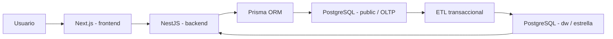

# Sistema académico ITSC - PostgreSQL

Sistema independiente para el Instituto Tecnológico Santa Cruz, desarrollado
con NestJS, Next.js, PostgreSQL y Prisma ORM. Conserva la identidad visual,
el logotipo, el modo oscuro y los procesos académicos del práctico anterior.
El proyecto terminado en PHP y MariaDB permanece separado.

Repositorio público del proyecto nuevo:
[COMANDAREMOS/itsc-sistema-academico-postgresql](https://github.com/COMANDAREMOS/itsc-sistema-academico-postgresql).

La aplicación se ejecuta localmente en `http://localhost:3000`. GitHub conserva
el código y los documentos; no ejecuta el servidor NestJS ni PostgreSQL.

## Documento del práctico y archivos para revisión

- [Práctico en Word con carátula diagramas y capturas](docs/Practico_ITSC_PostgreSQL_Vicente_Apaza_Bautista.docx).
- [Base de datos PostgreSQL con datos ficticios](db/ITSC_PostgreSQL_Demo.sql).
- [Diagrama de clases ejecutable en HTML](frontend/public/diagrama-clases.html).
- [Diagramas de arquitectura clases y esquema estrella](docs/diagramas/).

Para ejecutar el diagrama sin instalar el sistema, descargar el HTML y abrirlo
en un navegador. GitHub permite consultar su código; la aplicación completa
se inicia con las instrucciones de instalación.

Este es un trabajo académico con personas, empresas, importes y movimientos
ficticios. Las reglas de calificación reproducen la referencia utilizada en el
práctico; no constituyen una verificación legal actual de normativa institucional.

## Grupo e integrantes

| Dato | Registro del proyecto |
| --- | --- |
| Grupo | 10 - Instituto |
| Docente | Ing. Lozano Barro Jorge Robbert |
| Estudiante | Vicente Apaza Bautista |
| Usuario de GitHub informado | COMANDAREMOS |
| Segundo integrante informado | Quispe; nombre completo y usuario por confirmar por el grupo |

Los aportes individuales, autores de commits y revisiones deben registrarse
mediante el trabajo real de cada integrante. Esta documentación no sustituye
esas evidencias ni asigna aportes que no se hayan comprobado.

## Herramientas

| Herramienta | Versión utilizada |
| --- | --- |
| Node.js | 24.18.0; el proyecto requiere 24.15 o superior dentro de la serie 24 |
| NestJS | 12.3.2 |
| Next.js | 16.4.3 |
| PostgreSQL | 18.6 |
| Prisma ORM | 7.10.1 |
| Administración gráfica | pgAdmin 4 |

Se necesita npm, incluido con Node.js. Git permite conservar el historial y
preparar posteriormente el repositorio del grupo.

## Instalación y arranque

En la carpeta raíz, desde Símbolo del sistema o una terminal de desarrollo:

```bat
npm ci
npm run setup
npm run build
npm start
```

En la computadora ya configurada, `setup` utiliza las credenciales privadas
locales de PostgreSQL para crear únicamente la base nueva `itsc_postgres` y el
usuario de aplicación `itsc_pg_app`. Aplica las migraciones, prepara los datos
de demostración y crea los tres accesos iniciales. No abre MariaDB ni modifica
la base del proyecto anterior.

Para el uso diario basta con hacer doble clic en **INICIAR.cmd** y abrir
[http://localhost:3000](http://localhost:3000). Mantener abierta la ventana del
servidor mientras se utiliza la aplicación. Para detenerla, pulsar `Ctrl+C`.
También se puede detener mediante **DETENER.cmd** o `npm run stop`.

| Servicio | Dirección local |
| --- | --- |
| Página Next.js | http://localhost:3000 |
| API NestJS | http://127.0.0.1:4001/api |
| Estado del servidor | http://127.0.0.1:4001/api/health |
| PostgreSQL | 127.0.0.1:5432 |

En una computadora nueva se debe preparar primero PostgreSQL y proporcionar
al instalador una conexión administrativa local. La [guía de uso](docs/GUIA_DE_USO.md)
explica esa alternativa y las tareas de respaldo.

## Accesos y permisos

Las contraseñas iniciales se generan aleatoriamente. Se guardan fuera del
repositorio, en la carpeta privada del usuario:

```text
Documentos/Codex/Credenciales_Privadas/PostgreSQL_18/ITSC_PostgreSQL_accesos.json
```

| Usuario inicial | Rol | Función |
| --- | --- | --- |
| admin | ADMIN | Organización, admisión, grupos, evaluación, caja, usuarios y analítica |
| docente.demo | DOCENTE | Ofertas asignadas, notas, asistencia, planillas y resultados propios |
| caja.demo | CAJA | Consulta de estudiantes y operaciones de cargos, pagos y saldos |

Las credenciales del usuario `postgres` administran el motor de base de datos.
Son diferentes de los accesos a la página. La aplicación utiliza su propia
cuenta PostgreSQL sin privilegios de superusuario.

## Datos de demostración

| Catálogo o movimiento | Cantidad inicial |
| --- | ---: |
| Estudiantes ficticios en el catálogo | 1000 |
| Docentes ficticios | 80 |
| Carreras | 12 |
| Materias | 291 |
| Planes de estudio | 12 |
| Gestiones | 2 |
| Grupos | 4 |
| Matrículas | 50 |
| Inscripciones a materias | 150 |
| Ofertas | 12 |
| Evaluaciones | 24 |
| Calificaciones | 300 |
| Registros de asistencia | 150 |

Hay cuatro carreras adicionales y 24 materias identificadas como demostración.
Los 1000 estudiantes del catálogo no se presentan como 1000 matriculados.
El panel por gestión cuenta las matrículas y asignaciones efectivamente creadas.

| Gestión | Carrera | Grupo | Turno | Integrantes | Cupo |
| --- | --- | --- | --- | ---: | ---: |
| 2026 | Sistemas Informáticos | 1° A | Mañana | 30 | 35 |
| 2026 | Contaduría General | 1° A | Noche | 20 | 30 |
| 2027 | Sistemas Informáticos | 1° A | Mañana | 0 | 35 |
| 2027 | Electricidad Industrial | 1° B | Tarde | 0 | 25 |

Las ofertas iniciales permanecen abiertas para practicar calificaciones,
asistencia, cierre y recuperación. Los importes precargados son ficticios.

## Procesos principales

- Registro, búsqueda, paginación y edición de estudiantes y docentes.
- Carreras, materias, planes, pertenencia al plan y prerrequisitos sin ciclos.
- Gestiones, grupos por carrera, nivel, paralelo y turno, con tutor y cupos.
- Matrículas e inscripción individual o por grupo con validación de carrera,
  gestión, plan, prerrequisitos y capacidad.
- Horarios que controlan cruces de docente, aula y grupo, incluso entre
  gestiones cuyas fechas se superponen.
- Evaluaciones, notas, sesiones y asistencia individual o mediante planillas.
- Cierre académico, cálculo de resultados y recuperaciones definitivas.
- Cargos, abonos, recibos únicos, saldos y control de sobrepago.
- Documentación, trámites, pasantías y seguimiento de graduación.
- Exportación de reportes PDF y XLSX con filtros y permisos por rol.
- Analítica mediante un almacén de datos y un proceso ETL repetible.

## Base operativa, esquema estrella y ETL

La base tiene **40 tablas operativas**, tres vistas académicas y cinco
disparadores. El esquema `dw` agrega **6 dimensiones, 3 tablas de hechos y
1 registro de ejecuciones ETL**, además de tres vistas analíticas.



Para actualizar el almacén desde consola:

```bat
npm run etl
```

Administración también puede actualizarlo desde la sección de analítica de
la página. El ETL consulta el modelo operativo y actualiza únicamente `dw`.
Repetirlo no duplica hechos: usa las claves originales de matrícula,
inscripción y pago. Registra sus conteos y su estado; un error revierte la
actualización analítica.

Al inicio hay 50 hechos de matrícula, 20 de pago y 0 resultados cerrados. Cero
resultados es correcto mientras no se realice el cierre académico. Después
de cerrar o registrar una recuperación, actualizar el ETL para reflejarlo.

Los [diagramas OLTP y estrella](docs/ARQUITECTURA.md) y la explicación de
relaciones, seguridad y granos de los hechos están en la documentación técnica.

## Estructura del proyecto

```text
backend/       NestJS, autenticación, módulos, validaciones y reportes
frontend/      Next.js, interfaz institucional y modo oscuro
db/            Prisma, migraciones SQL, catálogo ficticio, seed y ETL
docs/          Arquitectura, diagramas y guía de uso
scripts/       Instalación, compilación, arranque y respaldos
tests/         Pruebas de integración y seguridad
.env.example   Variables necesarias sin credenciales reales
INICIAR.cmd    Arranque local después de instalar y compilar
```

## Comprobaciones

La integración que escribe datos se ejecuta contra una **base de pruebas
separada**, servida en el puerto 4002:

```powershell
$env:ITSC_API_URL = 'http://localhost:4002/api'
npm run test:integration
```

El informe queda en `.local/pruebas-integracion.json`. Comprueba sesiones y
roles, catálogos, operaciones académicas, grupos, cupos, horarios, caja y los
formatos PDF/XLSX. En el puerto principal 4001 el script realiza solo lectura,
salvo una habilitación explícita de escrituras para un entorno de pruebas.

No se recomienda ejecutar escenarios de escritura en una base con datos de
uso real. Las pruebas identifican sus registros con el prefijo `QA_PG_`.

## Trabajo del grupo y publicación

La guía del docente pide un repositorio con carpetas `backend`, `frontend`,
`db` y `docs`, instalación reproducible, modelos OLTP y estrella, ETL,
`.gitignore` y `.env.example`. También evalúa commits propios repartidos en el
tiempo, Pull Requests revisados por otros integrantes, Issues, tablero e hitos.

El proyecto nuevo se publica en el repositorio indicado al inicio. Las evidencias
de participación deben corresponder al trabajo real de los integrantes; no se
han sustituido con PRs o revisiones ficticias. El repositorio del proyecto PHP
terminado es una entrega diferente.

### Correspondencia con la guía del docente

La revisión se basa en la guía de Git y GitHub de ITSC 2026 proporcionada al
grupo, de nueve páginas. La arquitectura del proyecto final aparece en su
portada; la estructura de carpetas se indica en la página 3 y el contenido
del README, los modelos y el ETL en la página 7. El requisito de utilizar un
ORM también fue indicado en el mensaje del docente compartido por el estudiante.

| Requisito técnico | Evidencia en esta entrega |
| --- | --- |
| NestJS, Next.js y PostgreSQL | backend, frontend y base itsc_postgres |
| Carpetas backend/frontend/db/docs | Estructura separada de la entrega |
| ORM | Modelos y migraciones de Prisma |
| Modelo operativo OLTP | 40 tablas y diagrama completo en arquitectura |
| Esquema estrella | Seis dimensiones y tres hechos en dw |
| Proceso ETL | db/etl.mjs, npm run etl y actualización desde administración |
| Vistas e índices | Migraciones SQL de los dos esquemas |
| Instalación reproducible | package-lock.json, setup, build e INICIAR.cmd |
| Variables y exclusiones | .env.example y .gitignore |
| Guía y comprobaciones | Documentación de uso y scripts de pruebas |

Las evidencias de trabajo colaborativo en GitHub quedan a cargo del grupo:
nombres y usuarios confirmados de todos los integrantes,
commits propios, revisiones de PRs, Issues, tablero, hitos y capturas reales.
Solo deben presentarse como realizadas las acciones verificables en el repositorio.

Antes de publicar, revisar que no se incluyan `.env`, credenciales, copias de
seguridad, `node_modules`, compilaciones ni archivos de `.local`. Las
contraseñas privadas no deben copiarse al README ni a una captura pública.
