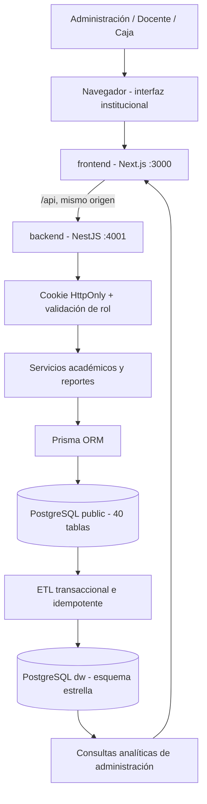
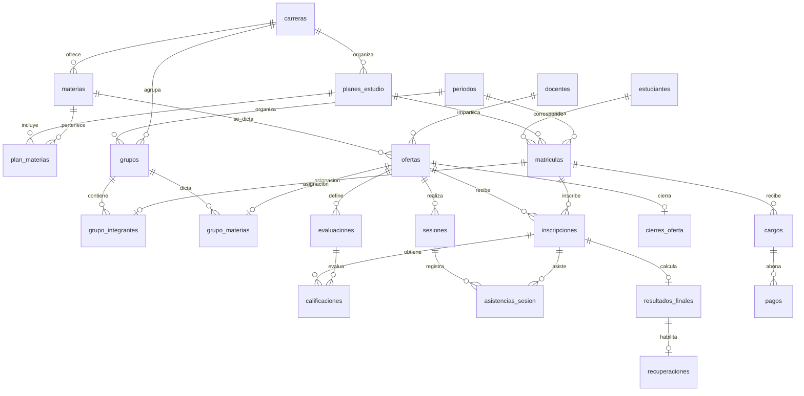
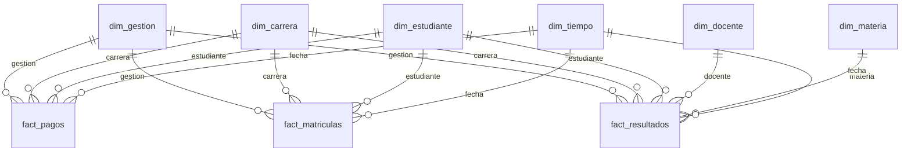

# Arquitectura y modelo de datos

## Aplicación independiente

El nuevo sistema del instituto utiliza Next.js para la interfaz, NestJS para
la API, Prisma ORM para el acceso al modelo y PostgreSQL como motor de datos.
El proyecto PHP/MariaDB terminado se conserva por separado.

Las carpetas de la entrega son `backend`, `frontend`, `db` y `docs`. Los
scripts de raíz preparan, compilan y arrancan los dos servicios. El navegador
consulta `/api` a través de Next.js; NestJS permanece en una interfaz local.

## Responsabilidades

| Capa | Función |
| --- | --- |
| Next.js | Formularios, filtros, listas paginadas, planillas, modo oscuro y descargas |
| NestJS | Sesión, autorización, validación, operaciones académicas y reportes |
| Prisma | Modelos tipados, relaciones, transacciones, migraciones y demostración |
| PostgreSQL public | Operaciones del instituto, claves, restricciones y disparadores |
| PostgreSQL dw | Dimensiones, hechos, historial de ETL y consultas analíticas |

## Modelo operativo OLTP

El modelo operativo contiene 40 tablas. Las relaciones compuestas aseguran
que ofertas, matrículas, materias, notas y sesiones correspondan a la misma
carrera o a la misma oferta cuando procede.

| Área | Tablas |
| --- | --- |
| Seguridad | app_usuarios, app_intentos, app_auditoria |
| Personas | estudiantes, docentes |
| Organización académica | carreras, materias, planes_estudio, plan_materias, prerrequisitos, reglas_evaluacion, periodos |
| Grupos | grupos, grupo_integrantes, grupo_materias |
| Admisión y clases | matriculas, ofertas, inscripciones, aulas, horarios, sesiones |
| Evaluación y resultados | evaluaciones, calificaciones, asistencias_sesion, excepciones_asistencia, cierres_oferta, resultados_finales, recuperaciones |
| Caja y documentación | cargos, pagos, tipos_documento, documentos_matricula |
| Seguimiento | tramites, pasantias, modalidades_graduacion, proyectos_graduacion, defensas, tribunales |
| Referencia histórica | notas_demo_historicas, asistencias_demo_historicas |

Las dos tablas de referencia histórica se conservan estructuralmente y
permanecen vacías en la nueva demostración. Los cálculos del sistema usan
evaluaciones, calificaciones y asistencia por sesión.

### Relaciones principales

El diagrama simplificado muestra el flujo académico. El modelo completo
de 40 tablas y 55 relaciones está declarado en `db/schema.prisma`; el siguiente
apartado contiene su representación con claves para revisión técnica.

```mermaid
erDiagram
    app_auditoria {
        int id PK
        int usuario_id FK
    }
    app_intentos {
        string clave PK
    }
    app_usuarios {
        int id PK
        int docente_id FK
    }
    asistencias_demo_historicas {
        int id PK
        int inscripcion_id FK
    }
    asistencias_sesion {
        int inscripcion_id PK,FK
        int sesion_id PK,FK
        int oferta_id FK
    }
    aulas {
        int id PK
    }
    calificaciones {
        int inscripcion_id PK,FK
        int evaluacion_id PK,FK
        int oferta_id FK
    }
    cargos {
        int id PK
        int matricula_id FK
    }
    carreras {
        int id PK
    }
    cierres_oferta {
        int oferta_id PK,FK
    }
    defensas {
        int id PK
        int proyecto_id FK
        int aula_id FK
    }
    docentes {
        int id PK
    }
    documentos_matricula {
        int id PK
        int matricula_id FK
        int tipo_documento_id FK
    }
    estudiantes {
        int id PK
    }
    evaluaciones {
        int id PK
        int oferta_id FK
    }
    excepciones_asistencia {
        int inscripcion_id PK,FK
    }
    grupo_integrantes {
        int id PK
        int grupo_id FK
        int matricula_id FK
    }
    grupo_materias {
        int id PK
        int grupo_id FK
        int oferta_id FK
    }
    grupos {
        int id PK
        int periodo_id FK
        int carrera_id FK
        int tutor_id FK
    }
    horarios {
        int id PK
        int oferta_id FK
        int aula_id FK
    }
    inscripciones {
        int id PK
        int matricula_id FK
        int oferta_id FK
        int carrera_id FK
        int periodo_id FK
    }
    materias {
        int id PK
        int carrera_id FK
    }
    matriculas {
        int id PK
        int estudiante_id FK
        int carrera_id FK
        int periodo_id FK
        int plan_id FK
    }
    modalidades_graduacion {
        int id PK
    }
    notas_demo_historicas {
        int id PK
        int inscripcion_id FK
    }
    ofertas {
        int id PK
        int materia_id FK
        int carrera_id FK
        int periodo_id FK
        int docente_id FK
    }
    pagos {
        int id PK
        int cargo_id FK
    }
    pasantias {
        int id PK
        int matricula_id FK
        int tutor_id FK
    }
    periodos {
        int id PK
    }
    plan_materias {
        int plan_id PK,FK
        int materia_id PK,FK
        int carrera_id FK
    }
    planes_estudio {
        int id PK
        int carrera_id FK
        int regla_id FK
    }
    prerrequisitos {
        int plan_id PK,FK
        int materia_id PK,FK
        int requerida_id PK,FK
    }
    proyectos_graduacion {
        int id PK
        int matricula_id FK
        int modalidad_id FK
        int tutor_id FK
    }
    recuperaciones {
        int inscripcion_id PK,FK
        int matricula_id FK
    }
    reglas_evaluacion {
        int id PK
    }
    resultados_finales {
        int inscripcion_id PK,FK
        int regla_id FK
    }
    sesiones {
        int id PK
        int oferta_id FK
    }
    tipos_documento {
        int id PK
    }
    tramites {
        int id PK
        int matricula_id FK
    }
    tribunales {
        int defensa_id PK,FK
        int docente_id PK,FK
    }
    app_usuarios ||--o{ app_auditoria : app_auditoria_ibfk_1
    docentes o|--o{ app_usuarios : app_usuarios_ibfk_1
    inscripciones ||--o{ asistencias_demo_historicas : asistencias_demo_historicas_ibfk_1
    inscripciones ||--o{ asistencias_sesion : asistencias_sesion_ibfk_1
    sesiones ||--o{ asistencias_sesion : asistencias_sesion_ibfk_2
    inscripciones ||--o{ calificaciones : calificaciones_ibfk_1
    evaluaciones ||--o{ calificaciones : calificaciones_ibfk_2
    matriculas ||--o{ cargos : cargos_ibfk_1
    ofertas ||--o| cierres_oferta : cierres_oferta_ibfk_1
    proyectos_graduacion ||--o{ defensas : defensas_ibfk_1
    aulas o|--o{ defensas : defensas_ibfk_2
    matriculas ||--o{ documentos_matricula : documentos_matricula_ibfk_1
    tipos_documento ||--o{ documentos_matricula : documentos_matricula_ibfk_2
    ofertas ||--o{ evaluaciones : evaluaciones_ibfk_1
    inscripciones ||--o| excepciones_asistencia : excepciones_asistencia_ibfk_1
    grupos ||--o{ grupo_integrantes : grupo_integrantes_ibfk_1
    matriculas ||--o| grupo_integrantes : grupo_integrantes_ibfk_2
    grupos ||--o{ grupo_materias : grupo_materias_ibfk_1
    ofertas ||--o| grupo_materias : grupo_materias_ibfk_2
    periodos ||--o{ grupos : grupos_ibfk_1
    carreras ||--o{ grupos : grupos_ibfk_2
    docentes o|--o{ grupos : grupos_ibfk_3
    ofertas ||--o{ horarios : horarios_ibfk_1
    aulas ||--o{ horarios : horarios_ibfk_2
    matriculas ||--o{ inscripciones : inscripciones_ibfk_1
    ofertas ||--o{ inscripciones : inscripciones_ibfk_2
    carreras ||--o{ materias : materias_ibfk_1
    estudiantes ||--o{ matriculas : matriculas_ibfk_1
    carreras ||--o{ matriculas : matriculas_ibfk_2
    periodos ||--o{ matriculas : matriculas_ibfk_3
    planes_estudio ||--o{ matriculas : matriculas_ibfk_4
    inscripciones ||--o{ notas_demo_historicas : notas_demo_historicas_ibfk_1
    materias ||--o{ ofertas : ofertas_ibfk_1
    periodos ||--o{ ofertas : ofertas_ibfk_2
    docentes ||--o{ ofertas : ofertas_ibfk_3
    cargos ||--o{ pagos : pagos_ibfk_1
    matriculas ||--o{ pasantias : pasantias_ibfk_1
    docentes o|--o{ pasantias : pasantias_ibfk_2
    planes_estudio ||--o{ plan_materias : plan_materias_ibfk_1
    materias ||--o{ plan_materias : plan_materias_ibfk_2
    carreras ||--o{ planes_estudio : planes_estudio_ibfk_1
    reglas_evaluacion ||--o{ planes_estudio : planes_estudio_ibfk_2
    plan_materias ||--o{ prerrequisitos : prerrequisitos_ibfk_1
    plan_materias ||--o{ prerrequisitos : prerrequisitos_ibfk_2
    matriculas ||--o{ proyectos_graduacion : proyectos_graduacion_ibfk_1
    modalidades_graduacion ||--o{ proyectos_graduacion : proyectos_graduacion_ibfk_2
    docentes o|--o{ proyectos_graduacion : proyectos_graduacion_ibfk_3
    resultados_finales ||--o| recuperaciones : recuperaciones_ibfk_1
    matriculas ||--o{ recuperaciones : recuperaciones_ibfk_2
    inscripciones ||--o| resultados_finales : resultados_finales_ibfk_1
    reglas_evaluacion ||--o{ resultados_finales : resultados_finales_ibfk_2
    ofertas ||--o{ sesiones : sesiones_ibfk_1
    matriculas ||--o{ tramites : tramites_ibfk_1
    defensas ||--o{ tribunales : tribunales_ibfk_1
    docentes ||--o{ tribunales : tribunales_ibfk_2
```

Modelo OLTP completo: 40 tablas y 55 relaciones

## Restricciones y transacciones

La migración inicial contiene 150 restricciones `CHECK`, además de claves
primarias, únicas y 55 relaciones. Los cinco disparadores validan asistencia
y elegibilidad de recuperación, y protegen recuperaciones definitivas.

Las reglas de aplicación agregan comprobaciones de cupos, plan, gestión,
prerrequisitos, horarios, permisos y cierre. Las escrituras académicas usan
transacciones y un bloqueo transaccional para serializar validaciones
concurrentes de recursos compartidos. Una operación de grupo o una planilla
inválida se revierte íntegramente.

Las tres vistas operativas son:

| Vista | Contenido |
| --- | --- |
| public.v_saldos | Cargos, abonos y saldo restante |
| public.v_listado_academico | Estudiante, carrera, gestión, materia y docente |
| public.v_boletin_final | Resultado de cierre y efecto de la recuperación |

## Esquema estrella

El esquema `dw` está separado del operativo. Sus seis dimensiones describen
gestión, carrera, estudiante, docente, materia y tiempo. Las tablas de hechos
mantienen un grano definido:

| Hecho | Grano | Medidas |
| --- | --- | --- |
| fact_matriculas | Una fila por matrícula | Cantidad 1 y estado |
| fact_resultados | Una fila por inscripción con resultado cerrado | Promedio, asistencia, nota final y aprobación |
| fact_pagos | Una fila por pago | Importe y método |

El almacén agrega 10 tablas: 6 dimensiones, 3 hechos y `etl_ejecuciones`.
En conjunto hay 50 tablas entre los dos esquemas. Los modelos de Prisma
declaran explícitamente `@@schema("public")` o `@@schema("dw")`.

## Extracción, transformación y carga

`db/etl.mjs` exporta `runEtl(prisma)` y también puede ejecutarse desde consola.
Las consultas SQL del proceso son estáticas; no interpolan fragmentos
recibidos desde un formulario.

1. Registrar el inicio de la ejecución.
2. Abrir una transacción con una instantánea consistente del origen.
3. Actualizar dimensiones desde los catálogos y el calendario.
4. Actualizar hechos de matrícula, resultado y pago mediante claves únicas.
5. Retirar del almacén filas derivadas cuyo origen haya dejado de existir.
6. Registrar conteos y finalizar la ejecución como completada.

Las dimensiones aplican actualización tipo 1: conservan el último valor del
catálogo y no simulan versiones históricas de nombres. Las claves de origen
permiten repetir la carga sin duplicaciones. El calendario cubre las fechas
de gestiones y movimientos del origen.

El ETL no cambia notas, matrículas, pagos ni otras tablas de `public`. Si
falla, revierte la actualización del almacén y registra el estado de error.
El esquema `dw` refleja la última ejecución correcta; no es una consulta en
vivo del modelo operativo.

| Vista analítica | Uso |
| --- | --- |
| dw.v_matriculas_por_gestion_carrera | Matrículas y estudiantes por gestión y carrera |
| dw.v_rendimiento_por_carrera | Inscripciones cerradas, promedio, asistencia y aprobación |
| dw.v_recaudacion_mensual | Pagos e importe por mes, gestión y carrera |

## Seguridad y alcance de permisos

- La sesión utiliza una cookie HttpOnly y SameSite Strict con duración limitada.
- La API comprueba el usuario activo y su rol en cada solicitud protegida.
- Las escrituras requieren la cabecera de verificación y un origen permitido.
- Las contraseñas de aplicación se guardan con salt y derivación scrypt.
- Cambiar la contraseña o desactivar un usuario invalida su sesión existente.
- El docente accede a sus ofertas; caja no accede a calificaciones.
- La analítica y la actualización ETL son operaciones de administración.
- Las credenciales locales y `.env` quedan fuera del repositorio publicable.

## Pruebas y evidencias

La compilación comprueba TypeScript y Next.js. Las pruebas HTTP de integración
ejercitan las operaciones y sus validaciones contra una base independiente
en el puerto 4002. Los resultados de cada ejecución se guardan en `.local`.

El código y los diagramas se publican en
[el repositorio del sistema PostgreSQL](https://github.com/COMANDAREMOS/itsc-sistema-academico-postgresql).
La participación individual, las revisiones de Pull Requests, los Issues y los
hitos deben reflejar acciones reales del grupo; no se simulan como evidencia
de evaluación.
